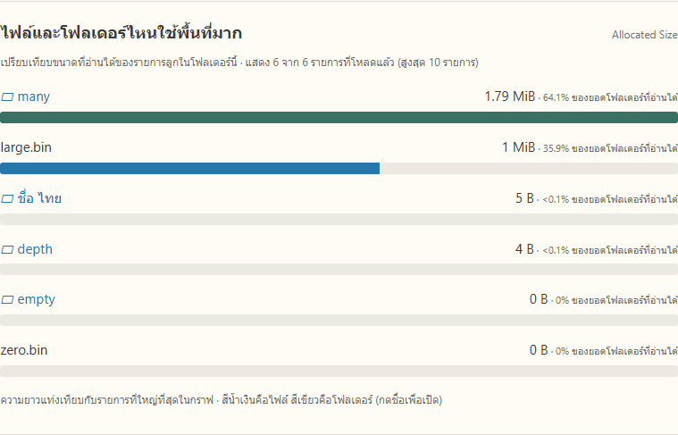
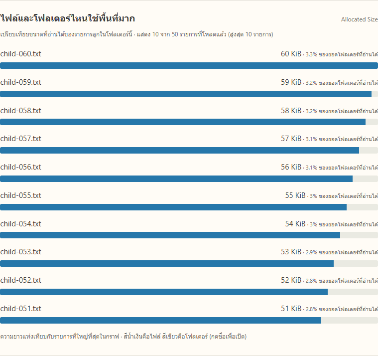

# กราฟแท่งพื้นที่ไฟล์และโฟลเดอร์

เพิ่มวันที่ 12 ตุลาคม 2569 โดยคง tree ตาราง ปุ่ม Scan/Cancel/Reveal รายการปัญหา และการเปิดผลเดิมไว้ ใช้ API เดิม ไม่มีไลบรารีกราฟหรือการเชื่อมอินเทอร์เน็ตเพิ่ม

## อ่านกราฟอย่างไร

- เปิดโฟลเดอร์แล้วกราฟแสดง Allocated Size ของรายการลูกที่โหลดแล้ว สูงสุด 10 รายการ เรียงขนาดมากไปน้อย
- ความยาวเทียบกับรายการที่ใหญ่ที่สุดในกราฟ ไม่ใช่เปอร์เซ็นต์ความจุไดรฟ์ สีน้ำเงินเป็นไฟล์ สีเขียวเป็นโฟลเดอร์ กดชื่อโฟลเดอร์ในกราฟเพื่อเปิดข้างในได้
- ตัวเลขเปอร์เซ็นต์คือขนาดรายการหารด้วยยอดโฟลเดอร์ที่อ่านได้ แสดงเมื่อยอดโฟลเดอร์มากกว่าศูนย์และมีค่าแล้วเท่านั้น
- ระหว่างสแกนใช้เฉพาะข้อมูลที่รับแล้ว อันดับเปลี่ยนได้ เมื่อจบจะโหลดข้อมูลใหม่ตามพฤติกรรมเดิม หากผลบางส่วน กราฟและเปอร์เซ็นต์อ้างเฉพาะยอดที่อ่านได้
- null ไม่ถูกวาดเป็นแท่งศูนย์ แสดงจำนวนที่ไม่ทราบจากรายการที่โหลดแล้วและให้ดูในตาราง ส่วน 0 B มีชื่อและตัวเลข แต่แท่งกว้างศูนย์
- ไม่รวมขนาดรายการแม่กับลูกซ้ำในกราฟเดียว และไม่รวมผลทั้งไดรฟ์ใน browser กราฟใช้ลูกโดยตรงของโฟลเดอร์ที่เลือก
- คำว่า “รายการที่โหลดแล้ว” สำคัญ โดยเฉพาะระหว่างสแกน กราฟไม่ได้รับรองว่าเป็นอันดับสูงสุดของข้อมูลที่ยังไม่อ่านหรือรายการที่วัดไม่ได้

## ผลตรวจ

1. ชุดตรวจข้อมูลกราฟผ่าน: เรียง 10 รายการ การคำนวณเปอร์เซ็นต์ ศูนย์/ไม่ทราบ ยอดที่ยังไม่สรุป โฟลเดอร์ว่าง ชื่อไทย และค่าขนาดผิดรูปแบบ
2. ผ่าน browser กับ Python HTTP/SQLite จริง 7 กรณี ใช้ข้อมูล fixture แยก ได้แก่ pagination, กดกราฟเข้าโฟลเดอร์, มือถือ, ระหว่างสแกนและเมื่อจบ, unknown และ zero รายละเอียด [size-bars-ui-check.json](results/size-bars-ui-check.json)
3. ชุดตรวจเดิมผ่าน: UI simulator 12 กรณี, HTTP contract 8 กรณี และ Python HTTP/SQLite 7 กรณี เป็นหลักฐานการรักษาฟีเจอร์เดิม ไม่ใช่ผลสแกน C
4. Python backend ชุดปัจจุบันพบ 35 ข้อ ผ่าน 23 ข้อ ข้าม 12 ข้อ: C tests 11 ข้อต้องรันใน Linux และการยกเลิกทั้งไดรฟ์จริง 1 ข้อไม่ได้เลือกเปิดในรอบนี้ ดู [ผล Windows](results/size-bars-backend-tests.txt)
5. C tests 11 ข้อรันใน Ubuntu แยกและผ่านแล้ว ดู [ผล C](results/size-bars-c-tests.txt)

### กราฟจาก C จริง

สร้าง fixture ใหม่ด้วย `-VariedSizes` แล้วสแกนจริงผ่าน C ใน Ubuntu WSL → Python บน Windows → เว็บ ได้ `completed`, `isSample=false`, 64 ไฟล์/13 โฟลเดอร์ ไม่มี error/skip ยอด Logical/Allocated ของ root บนเครื่องนี้ 2,922,505 ไบต์ `many` 1,873,920 ไบต์ และ `large.bin` 1,048,576 ไบต์ กราฟแสดงประมาณ 64.1% และ 35.9% ตามลำดับ ไม่ใช่ค่าจำลองหรือข้อมูล benchmark





รายละเอียด API อยู่ใน [size-bars-real-api.json](results/size-bars-real-api.json) ค่าที่สองขนาดเท่ากันใน fixture นี้ไม่ใช่ข้อสรุปว่าทุกไฟล์จะเท่ากัน การยกเลิก C ทั้งไดรฟ์มีหลักฐานย้อนหลังในผลรวมระบบรอบก่อน ไม่ได้รันซ้ำในรอบเพิ่มกราฟ

## ตรวจซ้ำ

```text
node tools/size-bars-check.cjs
node tools/size-bars-ui-check.cjs
```

ชุด browser ใช้แพ็กเกจ Playwright ในเครื่องและ Windows Python ตั้ง `PYTHON` เป็นตำแหน่งเต็มเมื่อต้องการ หากใช้ Chrome ที่ติดตั้งแล้วให้ตั้ง `CORESPACE_BROWSER_CHANNEL=chrome` ฐานข้อมูล/ไฟล์ fixture อยู่ในโฟลเดอร์ชั่วคราว ไม่ทับผลใช้งาน

ตัวเลือก `CORESPACE_UI_EVIDENCE` ของเครื่องมือตรวจ UI เดิมใช้เลือกโฟลเดอร์เก็บหลักฐานโดยไม่ทับผลรอบก่อน หน้าเว็บจริงเปิดตาม README และใช้ fixture ใหม่ตามคู่มือได้
