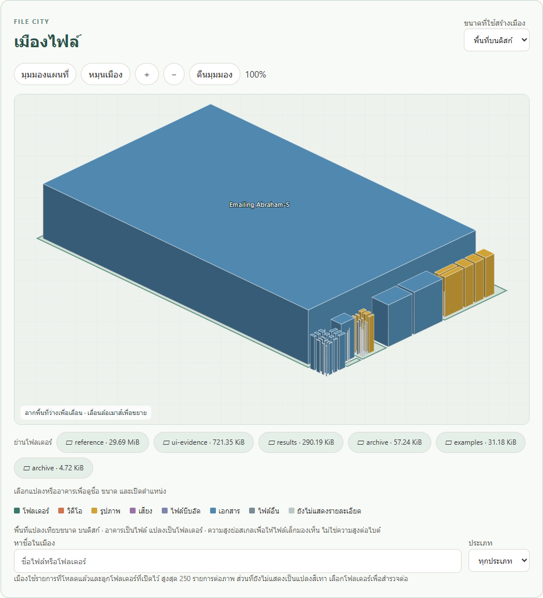

# ผลตรวจเมืองไฟล์และปุ่ม CoreSpace

ตรวจวันที่ 12 ตุลาคม 2569 บน Windows โดยใช้ Python server จริงและ C ใน Ubuntu WSL

## เวอร์ชันที่ตรวจ

ก่อนพัฒนา fetch GitHub แล้ว `origin/main` เป็น `ee591ad` ไม่มี main ใหม่กว่าไฟล์ในเครื่อง PR #6 ยังเปิดอยู่ งานเมืองต่อจาก branch `feature/folder-size-bars` เก็บการแก้ค้างของผู้ใช้ใน `backend/aggregator.py` ไว้โดยไม่รวมใน commit

## สิ่งที่ตรวจผ่าน

- [UAT ผ่าน C จริง 19 กรณี](file-city-uat.json): ปุ่ม Scan, เลือก/เข้าย่าน, อาคาร/ดูในตาราง, 50+10, map/city/rotate/zoom/reset, drag/wheel, ชื่อ/ประเภท, Logical/Allocated, เปิดผลล่าสุด, ลิงก์ผลเดิม, zero, Reveal, ยกเลิก C และเริ่มใหม่, junction/tree/refresh, ผลเดิมที่ไม่มี, path ผิด, มือถือ, ประวัติ และโฟลเดอร์เอกสารจริง
- fixture ที่สแกนผ่าน C จริงได้ 64 ไฟล์/13 โฟลเดอร์ ส่วน fixture junction แสดง `symlink` และเหตุผลที่ไม่เดินตาม
- การยกเลิกตรวจผ่าน UI จนได้สถานะ `cancelled` ภายในเวลารอ 15 วินาที แล้วเริ่มสแกนชุดถัดไปได้ ไม่ได้ใช้โปรแกรมจำลอง C ในชุดนี้
- [ขอบเขตเมืองผ่าน 4 กรณี](file-city-fixture-check.json): 400 รายการเป็นอาคารแยก 250 + พื้นที่รวม 1, เลือกพื้นที่รวม/ไปตาราง, ค้นรายการที่เกินจำนวนที่วาด, null กับขนาด Logical ที่ทราบ ชุดนี้ใช้ HTTP/SQLite กับข้อมูลที่เตรียมไว้ ไม่ใช่หลักฐานอ่านขนาดด้วย C/Windows
- ตัวตรวจข้อมูล `tools/file-city-check.cjs` ผ่านยอดรวม ไม่ซ้ำ parent/child พิกัด 4 มุม การรวมส่วนเกิน และ zero/null/ขนาดสองค่า
- ชุดเดิมผ่าน UI simulator 12 กรณี, HTTP contract 8 กรณี และ HTTP/SQLite 7 กรณี แยกไว้ใน [UI](file-city-original-ui.json), [contract](file-city-original-contract.json), [HTTP](file-city-original-http.json)
- กราฟแท่งเดิมผ่าน 7 กรณีอีกครั้ง ไม่มี page error

## สิ่งที่ UAT ช่วยให้แก้

1. Scan ที่ root โหลดก่อน C ส่งชื่อโฟลเดอร์: โหลดลูกที่พบใหม่หลังสแกนจบ เมืองจึงเห็นอาคารในย่าน และ tree เปิดลูกได้
2. HTML component ที่ปิดแบบ self-closing: เปลี่ยนเป็น closing tag เพื่อให้ตารางและกราฟยังแสดง
3. รายการมากเกินจำนวนที่วาด: รวมพื้นที่อย่างมีตัวเลขจริง และค้นไฟล์ที่โหลดแล้วนอกจำนวนที่วาดได้
4. พื้นที่รวมระดับ root: ปุ่มดูในตารางเลื่อนไปตารางโฟลเดอร์ได้ ไม่พยายามหาแถว root ที่ไม่มี
5. ข้อความส่วนผู้พัฒนาและโหมดสมมติ: หน้าปกติมีแต่ข้อมูลจริง ป้ายโหมดสมมติคงไว้เฉพาะ URL ทดสอบที่เลือกเอง
6. ผลสแกนที่อ่านไม่ได้กับโฟลเดอร์ว่าง: ใช้สถานะโฟลเดอร์ที่เลือก ไม่เรียกผลบางส่วนว่าโฟลเดอร์ว่าง
7. ไดรฟ์บนหน้าจอ: เปลี่ยนตาม path ที่กรอกและผลที่เปิดจากประวัติ

## ภาพจากผลจริง

ภาพจากชุด C จริงมี [root](file-city-real-root.png), [many](file-city-real-many.png) และ [มือถือ](file-city-mobile.png)

[ผลสแกนเอกสาร](file-city-project-status.json) เป็น snapshot ที่ได้ `completed`, `source=wsl`, `isSample=false`, 54 ไฟล์/7 โฟลเดอร์ ไม่มี error/skip จำนวนนี้เป็นของรอบที่เก็บภาพ เอกสารที่เพิ่มภายหลังอาจทำให้จำนวนเปลี่ยน

## ขอบเขตของหลักฐาน

Reveal ใช้คำขอจากปุ่มไปยัง Windows server จริงและได้ `revealed` หลังส่งคำสั่ง Explorer สำเร็จ ไม่ได้ตรวจว่าผู้ใช้เห็นหน้าต่างหรือเลือกแถวใน Explorer แล้ว

ยังไม่มีผลสแกนทั้งไดรฟ์ที่จบครบ และไม่ได้ทดสอบทุกสิทธิ์ NTFS ผลนี้ไม่ใช่ benchmark ไม่มีการเปรียบเทียบเวลา/หน่วยความจำกับต้นแบบ
