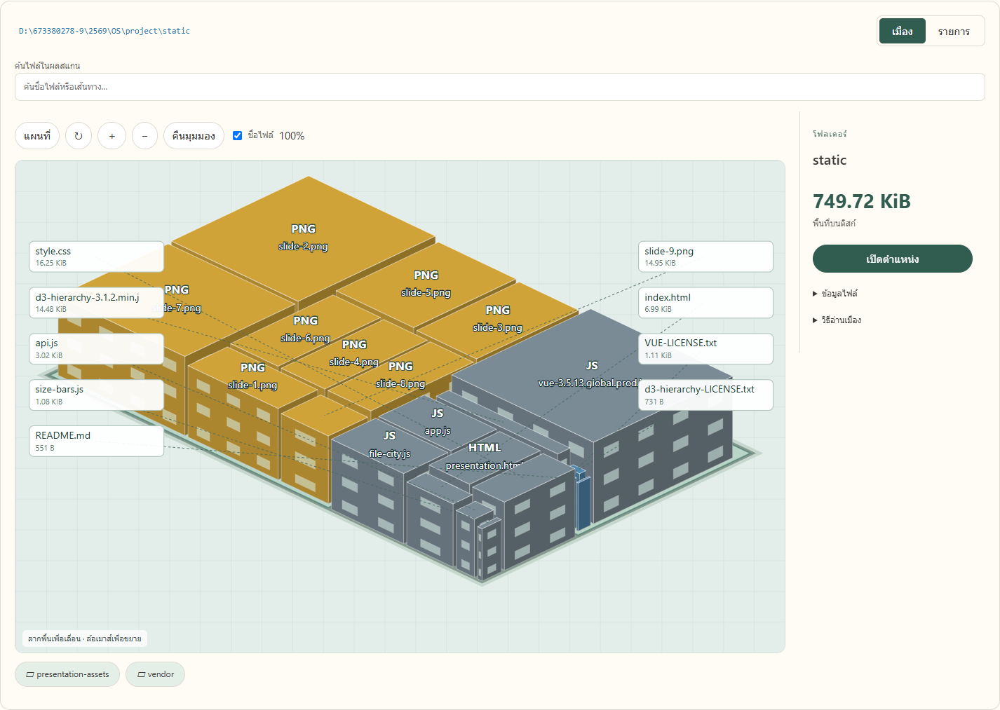
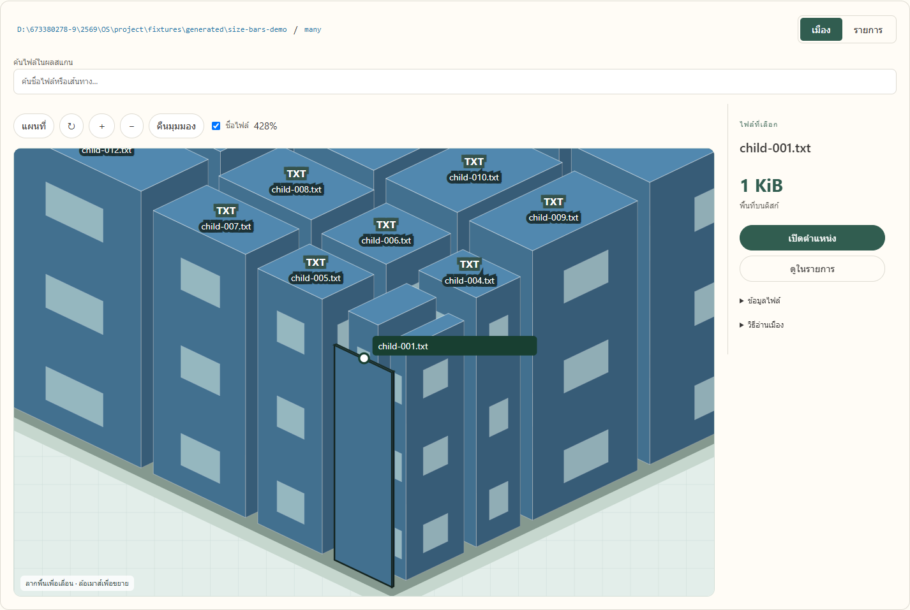

# ตรวจหน้าจอ UX รุ่นใหม่

12 ตุลาคม 2569 บน Windows จาก branch `feature/city-ux` ฐาน main `c752fda` หลัง PR #6 merge แล้ว

## สิ่งที่ตรวจจริง

- [UAT 16 กรณีผ่าน](ux-city-uat.json) ใช้ Windows Python จริง ไม่ดักคำตอบ API กรณีใช้งานหลักสแกนด้วย C ใน WSL และมีกรณีเชิงลบทดสอบว่าผล sample ถูกปฏิเสธโดยหน้าเว็บ
- ตรวจ UI ไม่มี mock/history/graph/tree ซ้ำ ชื่ออาคารและหน้าต่าง คลิกป้ายชื่อด้วยเมาส์ การเลือกค้างหลัง hover การค้นทั้งผลสแกนแม้ไฟล์อยู่นอกหน้าแรก สถานะ pending/result/log รายการ 50+10 สลับเมือง/รายการ หมุน/ซูม/คืนมุมมอง มือถือ เปิดผลเดิม Explorer Cancel/เริ่มใหม่ wildcard และภาพจากไฟล์โปรเจกต์จริง
- fixture ของชุด UAT เป็นไฟล์จริงที่ C อ่าน 64 ไฟล์/13 โฟลเดอร์ ไม่ใช่ข้อมูลสมมติที่ส่งให้ browser
- [Python regression](ux-backend-tests.txt) พบ 39 tests ผ่าน 22 ข้าม 17: C/Linux 11, ชุด real-C opt-in 3 และ WSL mock opt-in 3 ไม่ได้เปิดในคำสั่ง unittest รอบนี้ ผล C จริงของ UI มาจากชุด UAT แยกข้างต้น
- `tests/test_search.py` 4 ข้อผ่าน: 50+10/ไม่ซ้ำ, scan isolation/SQL parameters, Unicode/null และ Windows path
- ตัวตรวจข้อมูลเมืองเดิมผ่าน: ยอด parent/child ไม่รวมซ้ำ zero/null ขนาดสองค่า ส่วนเกิน 400 รายการ และพิกัด 4 มุม

## ตรวจภาพ

ภาพใช้ C อ่านไฟล์จริง ภาพแรกมาจากโฟลเดอร์ `static` ของโปรเจกต์ ดู [สถานะ snapshot](ux-project-status.json) ไม่ได้สร้าง UI หรือผลตรวจสมมติ

## ข้อจำกัดที่ต้องเข้าใจ

- ป้ายโยงชื่อแสดง 12 รายการเล็กต่อภาพ ป้ายอื่นดูได้จากการค้นหา/ซูม/เลือกและแผงรายละเอียด ไม่พยายามใส่ชื่อหลายร้อยชื่อทับกัน
- การค้นหาอ่านทั้งข้อมูลของ scan ใน SQLite ไม่เดินไฟล์ใหม่ ต้องสแกนใหม่เมื่อไฟล์ในเครื่องเปลี่ยน
- ประเภทไฟล์ดูจากนามสกุล และหน้าต่างอาคารเป็นการตกแต่ง พื้นที่ยังอ้างขนาดที่อ่านได้
- ผล Explorer ตรวจถึงคำสั่ง Windows สำเร็จ ไม่ได้ตรวจว่าผู้ใช้เห็นหน้าต่างแล้ว
- ยังไม่ได้ทดสอบทุกสิทธิ์ NTFS หรือรอสแกนทั้งไดรฟ์ครบ ไม่มี benchmark

หลักฐานเก่าที่ระบุ 19 กรณีและ UI mock 12 ข้อเป็นของรุ่นก่อน ใช้เอกสารนี้อ้างรุ่นปัจจุบัน และใช้ [UX_REDESIGN](../UX_REDESIGN.md) สำหรับเหตุผลการปรับ
